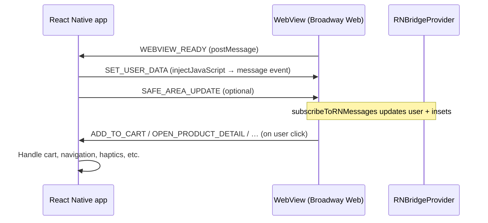

# Web ↔ App bridge — Frontend guide

Broadway Web runs inside a React Native **WebView**. The native app owns cart, checkout, navigation chrome, and device APIs. The web app owns OTA screens (`/sale`, `/home`, etc.) and talks to native through a **JSON message bridge**.

**Contract source of truth:** [`src/types/bridge.ts`](../src/types/bridge.ts)  
**Implementation:** [`src/lib/bridge/`](../src/lib/bridge/)  
**Native integration (for mobile team):** [`docs/react-native.md`](./react-native.md)

---

## 1. How Web and App communicate

### Architecture



### Channels

| Direction | Mechanism | Where it lives |
| --- | --- | --- |
| **Web → App** | `window.ReactNativeWebView.postMessage(JSON.stringify(msg))` | [`src/lib/bridge/bridge.ts`](../src/lib/bridge/bridge.ts) → `sendToReactNative()` |
| **App → Web** | Native injects JS that fires `window.postMessage` / `document` `message` | Web listens in `subscribeToRNMessages()` on `window` and `document` |

Every message uses the same envelope:

```ts
{
  type: string;           // see bridge.ts unions
  payload: unknown;       // shape depends on type
  timestamp?: number;     // always set on web → app
}
```

### Bootstrap (handshake)

When any page loads, `RNBridgeProvider` (wrapped in root [`src/app/layout.tsx`](../src/app/layout.tsx)) does the following:

1. Subscribes to incoming native messages.
2. Reads **URL query params** for WebView mode and safe area (see §4).
3. Sends **`WEBVIEW_READY`** with `{ route: window.location.pathname }`.

The native app should **wait for `WEBVIEW_READY`**, then send session data:

1. `SET_USER_DATA` (token, user profile)
2. `SAFE_AREA_UPDATE` (if insets were not on the URL)

Sending user data before the web listener is attached can drop messages.

### Detecting WebView vs browser

| Check | Use when |
| --- | --- |
| `useRNBridge().isWebView` | React components (also true if `?rn=true` or mobile UA during first paint) |
| `isReactNativeWebView()` from `@/lib/bridge` | `window.ReactNativeWebView.postMessage` exists (real RN host) |

In a desktop browser, `postMessage` to native is a no-op (logged + local `rn-bridge-message-sent` event). That is expected for local UI work.

### Debugging

The amber **WebView debug** overlay ( [`DebugOverlay`](../src/components/layout/DebugOverlay.tsx) ) shows:

- Incoming HTTP **request headers** (server capture — §3)
- **Native → Web** and **Web → Native** message timeline
- Whether the RN WebView object is present

---

## 2. Sending data to the App (web clicks → native actions)

### Preferred API: `useRNBridge()`

All bridge actions must run in **Client Components** (`"use client"`). The hook is only valid under `RNBridgeProvider` (already in root layout).

```tsx
"use client";

import { useRNBridge } from "@/lib/bridge";

export function ExampleActions() {
  const {
    addToCart,
    openProductDetail,
    buyNow,
    claimVoucher,
    sharePromotion,
    closeWebView,
    navigateToNative,
    triggerNativeHaptic,
    sendCustomMessage,
  } = useRNBridge();

  return (
    <>
      <button
        type="button"
        onClick={() =>
          addToCart({ id: "sku_1", title: "Tee", price: 499, quantity: 1 })
        }
      >
        Add to cart
      </button>
      <button
        type="button"
        onClick={() => openProductDetail("sku_1", { source: "sale_grid" })}
      >
        Open native PDP
      </button>
    </>
  );
}
```

Most helpers call **`triggerHaptic`** then **`sendToReactNative`** with a typed `type` and `payload`.

### Pattern: WebView vs standalone web

When the same control should **delegate to native in the app** but **stay on web in the browser**, gate on the host:

```tsx
import { isReactNativeWebView, useRNBridge } from "@/lib/bridge";

function isNativeHost() {
  if (typeof window === "undefined") return false;
  if (isReactNativeWebView()) return true;
  return new URLSearchParams(window.location.search).get("rn") === "true";
}

// In handler:
if (isNativeHost()) {
  addToCart(item);
  return;
}
router.push(`/sale/${product.id}`);
```

Reference: [`ProductCard`](../src/features/sale/components/ProductCard.tsx).

### Web → App message types (outgoing)

| `type` | `payload` | Typical native behavior |
| --- | --- | --- |
| `WEBVIEW_READY` | `{ route: string }` | App sends `SET_USER_DATA` |
| `ADD_TO_CART` | `{ id, title, price, quantity? }` | Update native cart |
| `OPEN_PRODUCT_DETAIL` | `{ productId, ...metadata }` | Open native product screen |
| `BUY_NOW` | `{ id, title, price }` | Start checkout |
| `CLAIM_VOUCHER` | `{ id, code, discount? }` | Apply voucher |
| `NAVIGATE_TO_NATIVE_SCREEN` | `{ screen, params? }` | React Navigation |
| `SHARE_PROMOTION` | `{ title, url }` | OS share sheet |
| `CLOSE_WEBVIEW` | `{ reason: 'USER_ACTION' }` | Pop WebView screen |
| `TRIGGER_HAPTIC` | `{ style: 'light' \| 'medium' \| 'heavy' \| 'success' \| 'warning' }` | Device haptic |
| `OPEN_DEEPLINK` | caller-defined | Open URL in app |
| `TRACK_ANALYTICS` | caller-defined | Analytics pipeline |

### Low-level: custom or future types

```tsx
const { sendCustomMessage } = useRNBridge();
sendCustomMessage("MY_NEW_EVENT", { foo: "bar" });
```

Or import `sendToReactNative` from `@/lib/bridge` (same retry behavior if RN injects `ReactNativeWebView` late).

**Coordinate with mobile** before adding new `type` strings—they must handle them in `WebView.onMessage`.

---

## 3. Receiving data from the App (user, token, headers)

There are **two** inputs. Use the right one for your layer (Server vs Client).

### A. Bridge: user session and token (primary for FE)

Native sends **`SET_USER_DATA`**. The provider merges into `useRNBridge().user`:

```ts
interface UserContextData {
  id?: string;
  name?: string;
  email?: string;
  token?: string;   // pass to authenticated client-side API calls
  vipTier?: string;
}
```

Example: wait for token, then fetch:

```tsx
"use client";

import { useEffect, useState } from "react";
import { useRNBridge } from "@/lib/bridge";

export function AuthenticatedScreen() {
  const { user } = useRNBridge();
  const [data, setData] = useState(null);

  useEffect(() => {
    if (!user.token) return;
    fetch("/api/...", { headers: { Authorization: `Bearer ${user.token}` } })
      .then((r) => r.json())
      .then(setData);
  }, [user.token]);

  if (!user.token) return <p>Waiting for session…</p>;
  // ...
}
```

Important:

- **Token is client-only.** It is not available in Server Components or `page.tsx` async server loaders unless you duplicate auth another way.
- Do **not** store secrets in URL query params.
- On logout, native should send `SET_USER_DATA` with `{}` or without `token`; optionally `REFRESH_PAGE`.

Other incoming types handled today:

| `type` | Effect |
| --- | --- |
| `SAFE_AREA_UPDATE` | Updates `safeAreaInsets` + CSS vars `--safe-top` / `--safe-bottom` |
| `REFRESH_PAGE` | `window.location.reload()` |
| `THEME_CHANGE`, `BACK_BUTTON_PRESSED` | Defined in types; **not handled yet** on web |

Read live values:

```tsx
const { user, safeAreaInsets, recentNativeEvents } = useRNBridge();
```

### B. HTTP request headers (server / initial load)

Root layout reads Next.js [`headers()`](https://nextjs.org/docs/app/api-reference/functions/headers) and passes them to `MobileContainer` for the debug overlay.

If the **native app sets custom headers** on the WebView’s initial document request (e.g. `x-device-id`, `authorization`), they appear in that object on **first SSR** for that navigation.

FE rules:

- **Do not rely on headers for token/session in feature code** unless product explicitly standardizes header names with mobile. Prefer **`user.token` from the bridge**.
- If you need headers in a Server Component, read them in `app/.../page.tsx` via `headers()` the same way as layout—not from `useRNBridge()`.

### Subscribing to raw incoming messages

For one-off handling outside context:

```tsx
import { useEffect } from "react";
import { subscribeToRNMessages } from "@/lib/bridge";

useEffect(() => {
  return subscribeToRNMessages((msg) => {
    if (msg.type === "SET_USER_DATA") {
      // ...
    }
  });
}, []);
```

Prefer extending `RNBridgeProvider` if many screens need the same incoming type.

---

## 4. Message shapes, safe area, and build

### Message shapes (quick reference)

Copy types from [`src/types/bridge.ts`](../src/types/bridge.ts). Outgoing payloads must match what mobile implements (see [`docs/react-native.md`](./react-native.md#web--native-you-handle-these)).

**Haptics:** bridge actions often fire haptics automatically; use `triggerNativeHaptic('light')` only when you need haptic without another action.

### Safe area

WebView screens should not sit under the notch or home indicator.

**Option 1 — URL (first paint):**

```
/sale?rn=true&safeTop=59&safeBottom=34
```

Aliases: `sat` / `top`, `sab` / `bottom`. If `rn=true` (or mobile UA) and values are omitted, defaults are **44** top and **24** bottom.

**Option 2 — message after load:**

Native sends `SAFE_AREA_UPDATE` with `{ top, bottom, left, right }`.

Layout padding uses `safeAreaInsets` in [`MobileContainer`](../src/components/layout/MobileContainer.tsx). CSS variables `--safe-top` and `--safe-bottom` are set for custom layouts.

### Build and run (local FE)

```bash
npm install
npm run dev      # http://localhost:3000
npm run build    # production bundle
npm run start    # serve production build
```

**Test in WebView (with mobile team):**

1. Run dev server on your machine.
2. Point the app WebView at a **specific path**, e.g. `http://<LAN-IP>:3000/sale?rn=true&safeTop=…&safeBottom=…`.
3. Android emulator → host machine often uses `http://10.0.2.2:3000`.
4. If dev WebView is blocked, add your LAN IP to [`next.config.ts`](../next.config.ts) → `allowedDevOrigins`.

**Test in browser only:**

- Open `http://localhost:3000/sale?rn=true` to simulate inset defaults and UI that checks `rn`.
- Bridge messages log in the console; native handlers will not run.

### Checklist for new interactive UI

- [ ] Component is `"use client"` if it uses `useRNBridge`.
- [ ] Click handler calls the right bridge method (or `sendCustomMessage` + mobile contract).
- [ ] Authenticated API calls use `user.token` after `SET_USER_DATA`, not server `page.tsx` fetch.
- [ ] WebView vs browser behavior is gated if the action differs (cart native vs web navigation).
- [ ] New `type` values added to `src/types/bridge.ts` and documented for mobile.

---

## File map

| File | Role |
| --- | --- |
| `src/types/bridge.ts` | Message type unions + payload interfaces |
| `src/lib/bridge/bridge.ts` | `sendToReactNative`, `subscribeToRNMessages`, `isReactNativeWebView` |
| `src/lib/bridge/context.tsx` | `RNBridgeProvider`, `useRNBridge`, handshake + user/insets |
| `src/app/layout.tsx` | Wraps app with provider; passes request headers |
| `docs/react-native.md` | Full native `WebView` setup, `postToWeb`, handshake |
